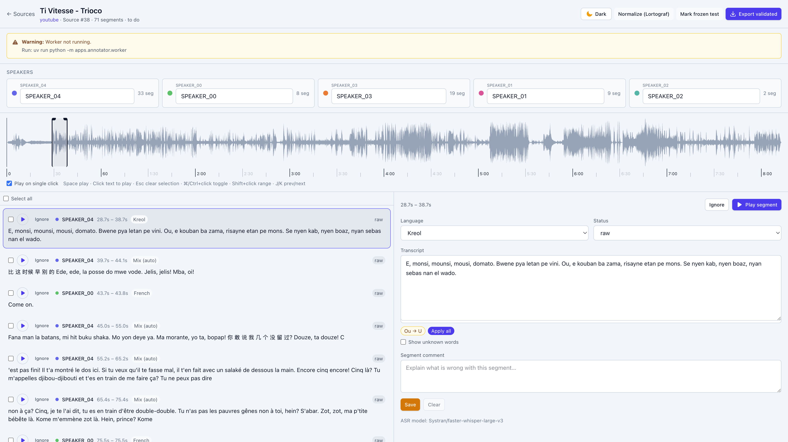

# MoTranscript

Speech annotation and training for **Mauritian Creole**, French, and English — including code-switching in the same conversation.

Built as a complete product: ingest audio, pre-transcribe with Whisper, correct in a waveform editor, normalize Kreol spelling (Lortograf), export a dataset, and fine-tune LoRA only when WER and CER improve on a frozen test set.



**Case study:** [samuelmamet.com/work/motranscript](https://samuelmamet.com/work/motranscript) · **Author:** [Samuel Mamet](https://samuelmamet.com)

> This project is **stable and complete**. There is no active roadmap; pull requests that fix clear bugs are welcome.

## Stack

| Layer | Tech |
| --- | --- |
| API | FastAPI, SQLAlchemy, Alembic, MySQL |
| UI | React, wavesurfer.js, Vite |
| ASR | faster-whisper, pyannote diarization, alignment |
| Training | PEFT LoRA, CTranslate2, Hugging Face Hub |
| Ops | Docker Compose, optional RunPod Serverless GPU |

## Quick start

```bash
./sail up      # db, api, web, worker
./sail down
./sail status
./sail logs
```

Open http://localhost:8010 (Vite proxies `/api` to port 8000).

Or manually:

```bash
docker compose up -d db
cp .env.example .env
uv sync
uv run alembic upgrade head
cd apps/annotator/web && npm install && npm run dev
uv run uvicorn apps.annotator.api.main:app --reload --port 8000
uv run python -m apps.annotator.worker
```

Default admin (change after first login): `admin@example.com` / `admin`. Set a strong `SECRET_KEY` in `.env`.

| Role | Can |
| --- | --- |
| **admin** | Ingest, delete, retranscribe, export, ASR registry, users |
| **operator** | Annotate: edit segments, speakers, Normalize |

## Give this repo to an AI

Cursor and other coding agents can set the project up for you. Point them at:

- [`.cursor/skills/setup/SKILL.md`](.cursor/skills/setup/SKILL.md) — step-by-step local install
- [`AGENTS.md`](AGENTS.md) — short entry point for any agent

Example prompt: *“Follow `.cursor/skills/setup/SKILL.md` and get MoTranscript running on my machine.”*

## Architecture

Annotation loop + training flywheel (VPS CPU, ephemeral GPU for ASR/train): see [docs/architecture.md](docs/architecture.md).

```
YouTube / upload → WAV → diarize + ASR + align
  → human correction in the editor
  → export validated set → LoRA train (if WER/CER improve)
  → register new CT2 model → better pre-transcripts
```

## Layout

- `apps/annotator/api` — FastAPI routes
- `apps/annotator/pipeline` — ingestion, ASR, diarization, alignment
- `apps/annotator/web` — React editor
- `apps/annotator/worker` — background jobs
- `training/` — LoRA scripts ([docs/training.md](docs/training.md))
- `normalizer/` — Lortograf lexicon + optional LLM pass
- `deploy/` — generic VPS / nginx / RunPod helpers ([docs/deploy.md](docs/deploy.md))

## Lortograf normalizer

- Per segment: **Normalize** in the transcript panel (Kreol / mix)
- Bulk: header **Normalize (Lortograf)** — preview, then apply
- Export warns if validated segments still use non-Lortograf spelling

Lexicon: `normalizer/lexicon/words.txt` and `aliases.txt`.

## License

[MIT](LICENSE) © Samuel Mamet
