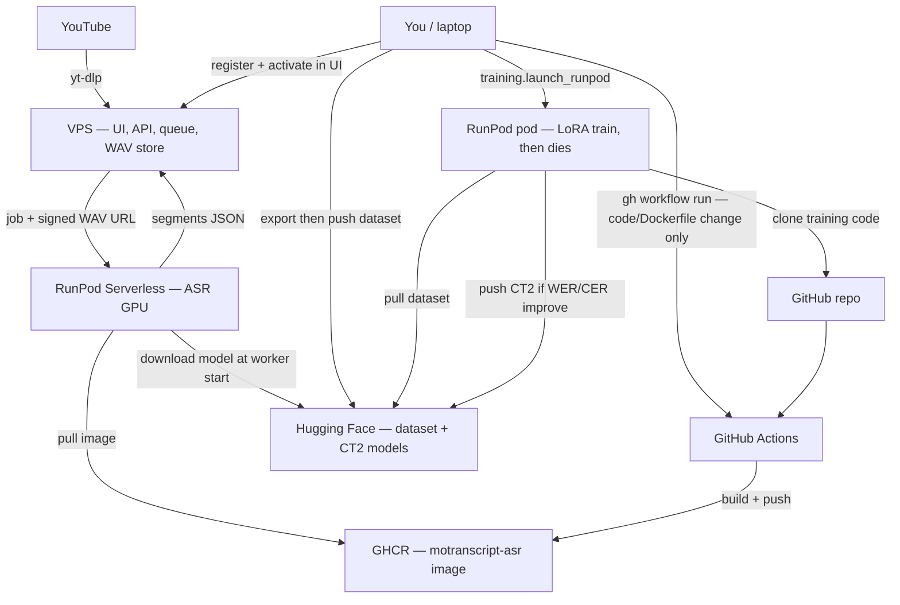

# Production architecture

Three loops share the same boxes. The VPS never rebuilds the GPU image.



## Who rebuilds the image?

**Not the VPS.** The dashed “recreate image?” arrow on the paper sketch should start from **you / laptop**, not from the VPS.

The workflow [`.github/workflows/runpod-asr-image.yml`](../.github/workflows/runpod-asr-image.yml) is `workflow_dispatch` only. Trigger:

```bash
gh workflow run runpod-asr-image.yml -f tag=v2
```

Then point the RunPod Serverless endpoint at the new tag. The VPS only stores `RUNPOD_ENDPOINT_ID`; it never talks to GHCR or GitHub Actions.

Rebuild the image when **handler / Dockerfile / ASR Python code** changes. A new LoRA on Hugging Face does **not** need a new image: change `WHISPER_MODEL` on the endpoint and restart workers so they download the new CT2 repo.

## What lives where

| Box | Stores / does |
| --- | --- |
| **VPS** | UI, MySQL, original WAVs, job queue. CPU only. |
| **GHCR** | Built GPU image: CUDA + Python + our code. **No ASR weights inside.** |
| **RunPod Serverless** | Pulls that image, downloads the active model from HF, transcribes. |
| **Hugging Face** | Training dataset + versioned CT2 models (`creole-asr-vN`). |
| **RunPod pod** | Ephemeral A40. Clones the repo, trains, pushes model, terminates. |
| **Laptop** | Triggers image builds, pushes datasets, launches training, activates models in the UI. |

## Loop 1 — Annotate (daily)

1. YouTube URL (or upload) → VPS downloads audio.
2. VPS worker submits a Serverless job with a signed WAV URL.
3. Worker pulls `ghcr.io/YOUR_GITHUB_USER/motranscript-asr:<tag>` if it does not already have it.
4. Worker downloads `WHISPER_MODEL` from Hugging Face (cached after cold start).
5. Worker fetches the WAV from the VPS, returns segments.
6. Humans correct and validate in the UI.

## Loop 2 — Train (occasional)

1. Sources page → **Export all validated** (JSONL + WAVs on the VPS disk).
2. From the laptop: `python -m training.dataset --push …` → Hugging Face dataset repo.
3. From the laptop: `python -m training.launch_runpod` → Community A40 pod.
4. Pod clones GitHub, pulls the dataset from HF, fine-tunes LoRA, evaluates on the frozen test set.
5. If WER **and** CER improve per language → merge → CT2 → push `creole-asr-vN`.
6. In the UI: register & activate that HF repo. Restart Serverless workers (env / hub download). **No image rebuild.**

The VPS does not start the training pod today. Training is launched from the laptop, as in [training.md](training.md).

## Loop 3 — Rebuild the ASR image (rare)

Only after changing `Dockerfile.runpod`, `deploy/runpod_handler.py`, or pipeline code that the Serverless worker runs.

1. Laptop: `gh workflow run runpod-asr-image.yml -f tag=vN`.
2. Actions builds linux/amd64 and pushes GHCR.
3. Update the Serverless endpoint `imageName` to that tag.
4. Next job pulls the new image.

The training pod uses a **generic** `runpod/pytorch:…` image, not `motranscript-asr`. Those two images are unrelated.

## Corrections vs the paper sketch

| Sketch | Actual |
| --- | --- |
| VPS → GitHub “recreate image?” | Laptop → GitHub Actions. VPS is not in this path. |
| Hugging Face → GitHub “pull latest model” | Hugging Face → **Serverless at runtime**. The image does not bake weights. |
| VPS → train pod “request train / send data” | Laptop launches the pod. Data goes VPS → (export) → laptop → HF → pod. |
| GitHub Docker image → Serverless “pull img” | Correct, via **GHCR** (`ghcr.io/YOUR_GITHUB_USER/motranscript-asr`). |
| VPS ↔ Serverless “infer” | Correct (signed audio URL in, segments out). |
| Train pod → Hugging Face “deploy model” | Correct, after the quality gate. |

Deploy steps: [deploy.md](deploy.md). Training commands: [training.md](training.md).
